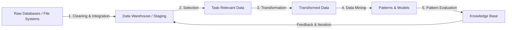
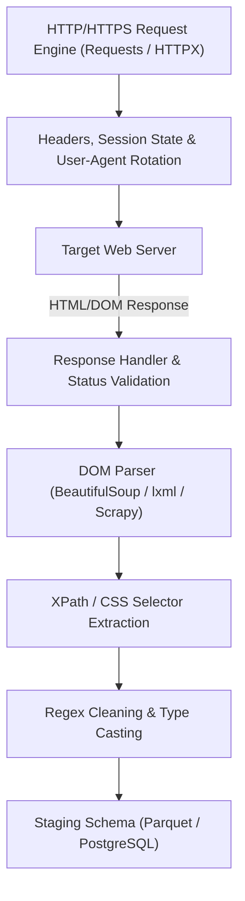
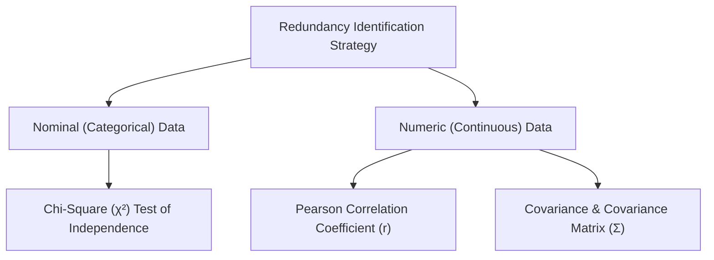
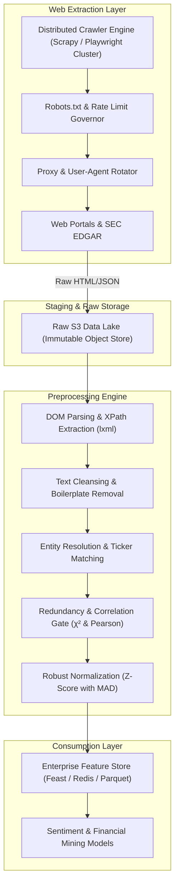

# Unit 1: Introduction to Data Mining & Data Preprocessing
**Course:** M.Tech Computer Science & Engineering | **Course Code:** `MTCS344E01` (Advanced Data Mining)  
**Primary Course Outcome:** `CO1` — Explain the basic fundamentals of Data mining and how to preprocess the data. (**Bloom's Revised Taxonomy: L2–L6**)  
**Textbook References:** 
- Jiawei Han, Micheline Kamber, Jian Pei, *Data Mining: Concepts and Techniques*, 3rd Edition, Chapters 1 & 3.
- Pang-Ning Tan, Michael Steinbach, Vipin Kumar, Anuj Karpatne, *Introduction to Data Mining*, 2nd Edition, Chapters 1 & 2.

---

## 1. Executive Summary & Curriculum Blueprint
Unit 1 establishes the architectural foundation of knowledge discovery and empirical data engineering. In modern enterprise settings, raw telemetry, transaction logs, and web crawls cannot be directly fed into machine learning models. Real-world data is inherently **dirty**: incomplete (lacking attribute values), noisy (containing errors or outliers), and inconsistent (containing discrepancies in codes or names). 

This guide covers:
1. **The Knowledge Discovery in Databases (KDD) Paradigm** versus classical Transaction Processing (OLTP/ETL) and Business Intelligence.
2. **Major Research and Engineering Challenges** in modern data mining systems.
3. **Web Data Acquisition (Web Scraping)**: Architectural components, DOM tree parsing, rate limiting, and ethical considerations.
4. **Data Preprocessing Dimensions**: Comprehensive treatment of the 6 data quality axes.
5. **Data Cleaning**: Imputation mechanisms for missing data and noise smoothing algorithms.
6. **Data Integration & Redundancy Analysis**: Rigorous mathematical treatment of nominal dependency ($\chi^2$ Test of Independence) and numerical correlation (Pearson's Product-Moment Coefficient $r$ and Covariance Matrix $\mathbf{\Sigma}$).
7. **Data Reduction**: Dimensionality reduction (PCA, attribute subset selection), Numerosity reduction (parametric regression, histograms, clustering, sampling), and Data compression.
8. **Data Transformation & Discretization**: Mathematical formulation of 4 normalization techniques (Min-Max, Z-score standard, Z-score with MAD $S_A$, Decimal Scaling) and Discretization via Binning (Equal-width, Equal-depth, Bin Mean smoothing, Bin Boundary smoothing).
9. **Exhaustive Solved Numericals**: Step-by-step arithmetic derivations matching every problem in the lecture notes, test sheets, and MSE papers.
10. **M.Tech 10-Marker Analytical Scenario Bank**: Advanced indirect exam questions at Bloom's Levels L2 through L6.

---

## 2. Theoretical Deep-Dive & Architectural Foundations

### 2.1 The KDD Process versus Enterprise ETL & Business Intelligence
Data mining is not an isolated algorithmic step, but the core analytical phase within the broader **Knowledge Discovery in Databases (KDD)** process.

#### The Seven Iterative Phases of KDD
1. **Data Cleaning:** Removal of noise, erroneous records, and inconsistent tuples.
2. **Data Integration:** Combining heterogeneous data sources (relational databases, flat files, data lakes) and resolving schema conflicts.
3. **Data Selection:** Querying and retrieving the subset of data relevant to the analytical objective from the consolidated data repository.
4. **Data Transformation:** Consolidating data into formats suitable for data mining through operations such as aggregation, normalization, and feature construction.
5. **Data Mining:** The application of intelligent algorithms (association, classification, clustering, regression, anomaly detection) to extract hidden patterns.
6. **Pattern Evaluation:** Identifying truly interesting patterns representing knowledge based on statistical interestingness measures (e.g., lift, confidence, silhouette score, ROC-AUC).
7. **Knowledge Presentation:** Visualizing and communicating discovered knowledge to domain stakeholders for decision support.

#### Hierarchical Positioning in Business Intelligence (BI)
In an enterprise architecture, the abstraction layers ascend from operational engineering to executive decision-making:
- **Bottom Layer (Data Sources):** DBAs and Data Engineers manage transactional databases (OLTP) and operational data stores.
- **Data Preprocessing & Warehousing Layer:** Consolidation into Enterprise Data Warehouses (EDW) and OLAP cubes.
- **Data Exploration Layer:** Data Analysts run statistical summaries, exploratory data analysis (EDA), and ad-hoc SQL querying.
- **Data Mining & Predictive Layer:** Data Scientists apply machine learning to discover latent associations, build classifiers, and predict future trends.
- **Top Layer (Decision Making):** Business executives and end-users leverage visual dashboards to make strategic capital, operational, and product decisions.

---

### 2.2 Major Issues and Open Challenges in Data Mining
Modern M.Tech examinations evaluate whether an engineer understands system bottlenecks. The major challenges in data mining span four core dimensions:

1. **Mining Methodology and User Interaction:**
   - *Mining diverse types of knowledge:* Discovering patterns across different granularities (multilevel, multidimensional, colossal).
   - *Incorporating background knowledge and constraints:* Guiding the search space via user constraints (anti-monotone, monotone, succinct) to avoid generating millions of trivial patterns.
   - *Handling noise and incomplete data:* Designing robust algorithms that degrade gracefully when data quality deteriorates.
   - *Pattern evaluation and expressiveness:* Avoiding the "data flood" where an algorithm produces more rules than raw data tuples.
2. **Performance, Scalability, and Efficiency:**
   - *Algorithmic scalability:* Ensuring linear or sub-linear time complexity $O(n)$ or $O(n \log n)$ as database volume scales from gigabytes to petabytes.
   - *Parallel, distributed, and incremental mining:* Designing streaming and map-reduce primitives that support online updates without re-scanning historical data from scratch.
3. **Handling Complex and Diverse Data Types:**
   - Mining semi-structured and unstructured data (web text, XML, JSON), temporal data, spatial-temporal trajectories, biological sequences, and graph/network topologies.
4. **Data Mining and Social Impacts:**
   - Privacy-preserving data mining, cryptographic differential privacy, algorithmic bias, model explainability (XAI), and regulatory compliance (GDPR, HIPAA).

---

### 2.3 Working with Web Data: Scraping & Pipeline Ingestion
Web scraping constitutes an essential data collection paradigm when target datasets are not exposed via structured REST/GraphQL APIs.

#### Web Scraping System Architecture

#### Key Technical Components
- **DOM Tree Parsing:** Web pages are structured as hierarchical Document Object Model (DOM) trees. Parsers convert raw byte streams into tree nodes accessible via **CSS Selectors** (e.g., `soup.select('div.article-title')`) or **XPath expressions** (e.g., `//div[@class="article"]/h2/text()`).
- **Dynamic Content Handling:** Modern single-page applications (SPAs) render data via client-side JavaScript. Headless browser automation (Playwright, Selenium) or reverse-engineering internal XHR/Fetch endpoints is necessary to extract asynchronously loaded payloads.
- **Politeness and Anti-Scraping Compliance:**
  - Adherence to `robots.txt` exclusion standards.
  - IP rotation, exponential backoff retries, and request rate-limiting to prevent Denial of Service (DoS) conditions on host infrastructure.
  - Custom `User-Agent` headers and cookie state management for authenticated sessions.

---

### 2.4 Data Quality: The Six Multidimensional Axes
Data preprocessing is motivated by the foundational reality: **"Garbage In, Garbage Out"**. High-performance data mining algorithms trained on poor-quality data produce deceptive patterns. 

| Quality Dimension | Formal Definition | Real-World Failure Scenario | Engineering Remedy |
| :--- | :--- | :--- | :--- |
| **1. Accuracy** | The degree to which data correctly reflects the ground-truth real-world entity or event. | Erroneous sensor calibration reporting negative absolute humidity or human typing error transposing digits (e.g., Age = 250). | Range checking, statistical outlier detection ($3\sigma$, Mahalanobis distance), cross-attribute rule validation. |
| **2. Completeness** | The extent to which expected data values are populated without missing fields. | Patient diagnosis records lacking blood pressure measurements or e-commerce purchases missing demographic tags. | Imputation (mean, median, regression imputation, KNN imputation, multiple imputation via MICE). |
| **3. Consistency** | The absence of contradictions across different database representations or across time. | Customer address recorded differently across billing vs shipping tables; date formats mixed (`DD/MM/YYYY` vs `MM/DD/YYYY`). | Schema reconciliation, primary key/foreign key integrity constraints, regex standardization. |
| **4. Timeliness** | The freshness and latency of the data relative to the event occurrence and decision cycle. | Real-time fraud detection engine operating on batch-updated credit scores that are 48 hours stale. | Transitioning to event-driven streaming pipelines (Kafka, Flink) and sliding window ingestion. |
| **5. Believability** | The degree to which data is accepted as authentic, trustworthy, and free from malicious tampering. | Web review dataset poisoned by competitor astroturfing bots or adversarial spoofing. | Cryptographic provenance logging, trust-weighting, bot anomaly filtering. |
| **6. Interpretability** | The ease with which the schema, data encoding, and semantics can be understood by algorithms and humans. | Legacy database column headers encoded as cryptic mnemonics (e.g., `CUST_STS_04 = 9`) without a data dictionary. | Metadata enrichment, categorical mapping to human-readable strings, automated schema registries. |

---

### 2.5 Data Cleaning: Missing Values and Noise Elimination

#### Handling Missing Data
Missing data manifests across three statistical mechanisms:
1. **MCAR (Missing Completely at Random):** Missingness is entirely independent of observed and unobserved data (e.g., random network packet drop).
2. **MAR (Missing at Random):** Missingness is systematically related to observed attributes but not the missing attribute itself (e.g., men rarely report depression symptoms, but within gender, missingness is random).
3. **MNAR (Missing Not at Random):** Missingness depends directly on the unobserved value itself (e.g., high-income individuals refusing to disclose salary).

**Standard Treatment Strategies:**
- **Ignore the Tuple (Listwise Deletion):** Discard records containing nulls. Effective only under MCAR when missingness affects $< 2\%$ of records. Severely biases models under MAR/MNAR.
- **Manual Imputation:** Feasible only for small, mission-critical datasets. Unscalable for big data.
- **Global Constant Replacement:** Fill with a placeholder like `Unknown` or $-\infty$. Risks creating artificial clusters during mining.
- **Central Tendency Imputation (Mean/Median):** Replace using the attribute mean for symmetric distributions, or attribute median for skewed distributions.
- **Class-Conditional Imputation:** Impute using the mean or median of tuples belonging to the same class label (e.g., average income of individuals within the same credit-risk tier).
- **Most Probable Value (Model-Based Imputation):** Predict the missing value using Bayesian networks, linear regression, or decision tree induction trained on complete attributes. Preserves multivariate covariance structures.

#### Smoothing Noisy Data
Noise is random error or variance in a measured variable.
- **Binning Methods:** Sorting data into discrete contiguous intervals ("bins") and smoothing locally:
  - *Smoothing by Bin Means:* Every value in a bin is replaced by the arithmetic mean of the bin.
  - *Smoothing by Bin Medians:* Every value in a bin is replaced by the median value of the bin (minimizes sensitivity to local outliers).
  - *Smoothing by Bin Boundaries:* The minimum and maximum values in a bin are identified as boundaries. Each value in the bin is replaced by its closest boundary value based on absolute difference.
- **Regression:** Fitting data to mathematical functions:
  - Linear regression fits a straight line: $y = mx + b$.
  - Multiple linear regression fits multidimensional hyperplanes: $y = b_0 + \sum b_i x_i$. Outlier deviations from the regression line are flagged or smoothed.
- **Clustering:** Partitioning data into clusters. Objects falling outside cluster boundaries or isolated in sparse micro-clusters are identified and removed as noise.

---

### 2.6 Data Integration: Redundancy Analysis & Statistical Tests
Data integration merges data from multiple heterogeneous stores into a unified schema. A central hazard during integration is **redundancy** — an attribute that is redundant because it can be derived from other attributes, or attributes that measure the same underlying phenomenon under different names. Redundancy causes inconsistent updates and skews machine learning models.

---

#### 2.6.1 Nominal Data: Chi-Square ($\chi^2$) Test of Independence
When two attributes $A$ and $B$ are categorical (nominal), statistical correlation is evaluated using the **Chi-Square ($\chi^2$) Test of Independence**.

##### Mathematical Formulation
Let attribute $A$ possess $c$ distinct categorical states $\{a_1, a_2, \dots, a_c\}$, and attribute $B$ possess $r$ distinct states $\{b_1, b_2, \dots, b_r\}$. The joint frequency distribution is represented as an $r \times c$ **contingency table**.

1. **Hypothesis Formulation:**
   - **Null Hypothesis ($H_0$):** Attributes $A$ and $B$ are **independent** (uncorrelated). There is no relationship between the categories of $A$ and $B$.
   - **Alternative Hypothesis ($H_a$):** Attributes $A$ and $B$ are **dependent** (correlated). A statistically significant relationship exists.
2. **Expected Frequency Computation:**
   Under the null hypothesis of independence, the expected frequency $e_{ij}$ for cell $(i, j)$ is given by the product of the marginal probabilities:
   $$e_{ij} = \frac{\text{Count}(A = a_i) \times \text{Count}(B = b_j)}{n} = \frac{(\text{Column } j \text{ Total}) \times (\text{Row } i \text{ Total})}{n}$$
   where $n$ is the total sample size (grand total).
3. **Chi-Square Test Statistic:**
   $$\chi^2 = \sum_{i=1}^{r} \sum_{j=1}^{c} \frac{(o_{ij} - e_{ij})^2}{e_{ij}}$$
   where $o_{ij}$ is the observed frequency in cell $(i, j)$.
4. **Degrees of Freedom ($df$):**
   $$df = (r - 1)(c - 1)$$
5. **Decision Rule:**
   Compare the computed $\chi^2$ statistic against the critical value $\chi^2_{\alpha, df}$ obtained from the Chi-Square distribution table at significance level $\alpha$ (typically $\alpha = 0.05$ or $\alpha = 0.01$):
   $$\text{If } \chi^2 > \chi^2_{\alpha, df} \implies \text{Reject } H_0 \quad (\text{Attributes are correlated / dependent})$$
   $$\text{If } \chi^2 \le \chi^2_{\alpha, df} \implies \text{Fail to reject } H_0 \quad (\text{Attributes are independent})$$

---

#### 2.6.2 Numeric Data: Pearson Correlation Coefficient ($r$)
For continuous numeric attributes $A$ and $B$, linear correlation is measured using **Pearson's Product-Moment Correlation Coefficient** ($r_{A,B}$).

##### Mathematical Formulas
Given $n$ paired observations $(a_1, b_1), (a_2, b_2), \dots, (a_n, b_n)$:

$$\begin{aligned}
r_{A,B} &= \frac{\sum_{i=1}^n (a_i - \bar{A})(b_i - \bar{B})}{(n - 1)\sigma_A \sigma_B} \\
&= \frac{\sum_{i=1}^n a_i b_i - n\bar{A}\bar{B}}{(n - 1)\sigma_A \sigma_B} \\
&= \frac{n \sum XY - (\sum X)(\sum Y)}{\sqrt{\big[n \sum X^2 - (\sum X)^2\big]\big[n \sum Y^2 - (\sum Y)^2\big]}}
\end{aligned}$$

##### Geometric & Statistical Interpretation
- **Range:** $-1 \le r_{A,B} \le +1$.
- **$r > 0$ (Positive Correlation):** As values of $A$ increase, values of $B$ increase linearly. Strong positive correlation ($r \to +1$) indicates redundancy.
- **$r < 0$ (Negative Correlation):** As values of $A$ increase, values of $B$ decrease linearly.
- **$r = 0$ (Uncorrelated):** No linear relationship exists between $A$ and $B$. (Note: Non-linear relationships such as $Y = X^2$ can still exist even when $r = 0$).

---

#### 2.6.3 Covariance and the Covariance Matrix ($\mathbf{\Sigma}$)
Covariance measures the joint variability of two random variables.

##### Mathematical Formulation
- **Population Covariance:**
  $$Cov(A, B) = E\big[(A - \bar{A})(B - \bar{B})\big] = E(A \cdot B) - \bar{A}\bar{B}$$
- **Sample Covariance:**
  $$Cov(A, B) = \frac{1}{n - 1}\sum_{i=1}^n (a_i - \bar{A})(b_i - \bar{B})$$

##### Relationship Between Covariance and Correlation
$$r_{A,B} = \frac{Cov(A, B)}{\sigma_A \sigma_B}$$
Unlike the dimensionless correlation coefficient $r \in [-1, +1]$, covariance depends on the scale of measurement (units of $A \times$ units of $B$).

##### Covariance Matrix ($\mathbf{\Sigma}$) for $d$-Dimensional Data
For a dataset with $d$ variables, the $d \times d$ covariance matrix summarizes all pairwise variances and covariances:
$$\mathbf{\Sigma} = \begin{bmatrix}
Var(X_1) & Cov(X_1, X_2) & \cdots & Cov(X_1, X_d) \\
Cov(X_2, X_1) & Var(X_2) & \cdots & Cov(X_2, X_d) \\
\vdots & \vdots & \ddots & \vdots \\
Cov(X_d, X_1) & Cov(X_d, X_2) & \cdots & Var(X_d)
\end{bmatrix}$$
Since $Cov(X_i, X_j) = Cov(X_j, X_i)$, $\mathbf{\Sigma}$ is always a **symmetric, positive semi-definite matrix**.

---

### 2.7 Data Reduction Strategies
Data reduction produces a reduced representation of the dataset that is vastly smaller in volume yet maintains the analytical integrity of the original data.

#### 1. Dimensionality Reduction
Reduces the number of random variables or attributes under consideration.
- **Principal Component Analysis (PCA):** An orthogonal linear transformation that maps $d$-dimensional correlated data into a new $k$-dimensional orthogonal coordinate system ($k \ll d$) such that the greatest variance by any projection lies on the first principal component (eigenvector corresponding to the largest eigenvalue of $\mathbf{\Sigma}$).
- **Wavelet Transforms (DWT):** Decomposes a data vector into different frequency sub-bands, preserving both relative spatial information and spectral energy.
- **Attribute Subset Selection:** Removing redundant or uninformative attributes via heuristic search:
  - *Stepwise Forward Selection:* Starts with an empty set and iteratively adds the best attribute.
  - *Stepwise Backward Elimination:* Starts with the full attribute set and iteratively removes the least significant attribute.
  - *Decision Tree Induction:* Non-leaf nodes selected during tree construction form the reduced feature subset.

#### 2. Numerosity Reduction
Replaces original data with alternative, smaller representations.
- **Parametric Methods:** Fit data to a mathematical model (e.g., linear regression $y = mx+b$ or log-linear models) and store only the model parameters.
- **Non-Parametric Methods:**
  - *Histograms:* Divide attribute range into buckets (equal-width or equal-frequency) and store count summaries.
  - *Clustering:* Cluster data and represent entire clusters by their centroids and radii.
  - *Sampling:* Selecting a representative subset:
    - Simple Random Sampling Without Replacement (SRSWOR).
    - Simple Random Sampling With Replacement (SRSWR).
    - Stratified Sampling: Partitioning into disjoint strata and sampling proportionally from each stratum (vital for imbalanced data).

---

### 2.8 Data Transformation & Discretization

#### 2.8.1 The Four Data Normalization Techniques
Normalizing continuous features scales data to fall within a uniform range, preventing attributes with large magnitudes (e.g., Annual Income $\$100,000$) from disproportionately dominating distance metrics over small-magnitude attributes (e.g., Age $25$).

##### 1. Min-Max Normalization
Linearly transforms a value $v$ of attribute $A$ into $v'$ within the target range $[new\_\min_A, new\_\max_A]$:

$$v_i' = \frac{v_i - \min_A}{\max_A - \min_A}\big(new\_\max_A - new\_\min_A\big) + new\_\min_A$$

- Standard target range is $[0, 1]$, where the formula simplifies to:
  $$v_i' = \frac{v_i - \min_A}{\max_A - \min_A}$$
- *Limitation:* Highly sensitive to extreme outliers; if a future input exceeds $[\min_A, \max_A]$, an "out-of-bounds" error occurs.

##### 2. Z-Score Normalization (Standardization / Zero-Mean)
Transforms values based on the mean $\mu_A$ (or sample mean $\bar{A}$) and standard deviation $\sigma_A$:

$$v_i' = \frac{v_i - \bar{A}}{\sigma_A}$$

where:
$$\bar{A} = \frac{1}{n}\sum_{i=1}^n v_i, \qquad \sigma_A = \sqrt{\frac{1}{n}\sum_{i=1}^n (v_i - \bar{A})^2} \quad (\text{or } s_A \text{ with divisor } n-1)$$

- The resulting normalized attribute has mean $\mu = 0$ and variance $\sigma^2 = 1$.
- Preferred when the true minimum and maximum are unknown or when outliers are present.

##### 3. Z-Score Normalization using Mean Absolute Deviation ($S_A$)
Standard deviation $\sigma_A$ squares differences $(v_i - \bar{A})^2$, which excessively magnifies the weight of outliers. Replacing $\sigma_A$ with the **Mean Absolute Deviation ($S_A$)** provides a strictly robust estimator:

$$v_i' = \frac{v_i - \bar{A}}{S_A}$$

where:
$$S_A = \frac{1}{n}\sum_{i=1}^n |v_i - \bar{A}|$$

- Because deviations are not squared, $S_A$ prevents extreme outlier spikes from artificially compressing normal data points toward zero.

##### 4. Normalization by Decimal Scaling
Normalizes by moving the decimal point of values of attribute $A$:

$$v_i' = \frac{v_i}{10^j}$$

where $j$ is the smallest integer such that $\max(|v_i'|) < 1$ (or $\le 1$ depending on standard convention). Formally:
$$j = \lceil \log_{10}(\max(|A|) + 1) \rceil$$

---

#### 2.8.2 Discretization & Binning
Discretization transforms continuous numeric attributes into discrete categorical or ordinal intervals.
- **Equal-Width (Equi-Width) Partitioning:** Divides the range of attribute $A$ into $k$ intervals of equal size:
  $$W = \frac{\max_A - \min_A}{k}$$
  Susceptible to skewed data where outliers cause most bins to remain empty.
- **Equal-Depth (Equal-Frequency / Equi-Depth) Partitioning:** Divides the sorted values into $k$ intervals such that each bin contains an approximately equal number of samples ($n/k$). Excellent for handling skewed distributions.

---

## 3. Exhaustive Solved Numericals (Complete Step-by-Step Rigor)

---

### Numerical 1.1: Chi-Square ($\chi^2$) Test of Independence (1500 Subjects)
*(From Class Notebook Pages 1–3, Test Problem Sheet Pages 1–3)*

#### Problem Statement
A market research organization surveyed $1500$ people. The gender of each participant was recorded alongside their preferred reading material (Fiction vs Non-Fiction). The observed contingency table is given below:

| Preferred Reading | Male ($M$) | Female ($F$) | Total |
| :--- | :---: | :---: | :---: |
| **Fiction** | $250$ | $200$ | **$450$** |
| **Non-Fiction** | $50$ | $1000$ | **$1050$** |
| **Total** | **$300$** | **$1200$** | **$n = 1500$** |

Using the Chi-Square test for independence:
1. State the Null and Alternative Hypotheses.
2. Compute the matrix of expected frequencies.
3. Compute the Chi-Square ($\chi^2$) test statistic.
4. Determine the degrees of freedom.
5. Given critical values $\chi^2_{0.05, 1} = 3.841$ and $\chi^2_{0.01, 1} = 10.828$, draw the statistical conclusion.

---

#### Complete Step-by-Step Solution

##### Step 1: Hypotheses Formulation
- **Null Hypothesis ($H_0$):** Gender and preferred reading material are **independent** (uncorrelated).
- **Alternative Hypothesis ($H_a$):** Gender and preferred reading material are **dependent** (correlated).

##### Step 2: Expected Frequency Calculation
Formula:
$$e_{ij} = \frac{(\text{Row } i \text{ Total}) \times (\text{Column } j \text{ Total})}{n}$$

1. **For Cell $(1, 1)$ — [Fiction, Male]:**
   $$e_{11} = \frac{\text{Count}(\text{Fiction}) \times \text{Count}(\text{Male})}{n} = \frac{450 \times 300}{1500} = \frac{135000}{1500} = 90.0$$
2. **For Cell $(1, 2)$ — [Fiction, Female]:**
   $$e_{12} = \frac{\text{Count}(\text{Fiction}) \times \text{Count}(\text{Female})}{n} = \frac{450 \times 1200}{1500} = \frac{540000}{1500} = 360.0$$
3. **For Cell $(2, 1)$ — [Non-Fiction, Male]:**
   $$e_{21} = \frac{\text{Count}(\text{Non-Fiction}) \times \text{Count}(\text{Male})}{n} = \frac{1050 \times 300}{1500} = \frac{315000}{1500} = 210.0$$
4. **For Cell $(2, 2)$ — [Non-Fiction, Female]:**
   $$e_{22} = \frac{\text{Count}(\text{Non-Fiction}) \times \text{Count}(\text{Female})}{n} = \frac{1050 \times 1200}{1500} = \frac{1260000}{1500} = 840.0$$

**Expected Frequency Matrix ($E$):**
| Preferred Reading | Male ($M$) | Female ($F$) | Row Sum Check |
| :--- | :---: | :---: | :---: |
| **Fiction** | $e_{11} = 90$ | $e_{12} = 360$ | $90 + 360 = 450$ ✓ |
| **Non-Fiction** | $e_{21} = 210$ | $e_{22} = 840$ | $210 + 840 = 1050$ ✓ |
| **Col Sum Check** | $90 + 210 = 300$ ✓ | $360 + 840 = 1200$ ✓ | **$1500$** ✓ |

##### Step 3: Chi-Square ($\chi^2$) Statistic Computation
Formula:
$$\chi^2 = \sum_{i=1}^2 \sum_{j=1}^2 \frac{(o_{ij} - e_{ij})^2}{e_{ij}}$$

| Cell $(i, j)$ | Observed ($o_{ij}$) | Expected ($e_{ij}$) | Deviation $(o_{ij} - e_{ij})$ | $(o_{ij} - e_{ij})^2$ | $\frac{(o_{ij} - e_{ij})^2}{e_{ij}}$ |
| :---: | :---: | :---: | :---: | :---: | :---: |
| $(1, 1)$ [Fict, M] | $250$ | $90$ | $+160$ | $25600$ | $\frac{25600}{90} \approx 284.444$ |
| $(1, 2)$ [Fict, F] | $200$ | $360$ | $-160$ | $25600$ | $\frac{25600}{360} \approx 71.111$ |
| $(2, 1)$ [NonF, M] | $50$ | $210$ | $-160$ | $25600$ | $\frac{25600}{210} \approx 121.905$ |
| $(2, 2)$ [NonF, F] | $1000$ | $840$ | $+160$ | $25600$ | $\frac{25600}{840} \approx 30.476$ |
| **Total** | **$1500$** | **$1500$** | **$0$** | — | **$\chi^2 = 507.936$** |

$$\chi^2 = 284.444 + 71.111 + 121.905 + 30.476 = 507.936$$

##### Step 4: Degrees of Freedom ($df$)
$$df = (r - 1)(c - 1) = (2 - 1)(2 - 1) = 1 \times 1 = 1$$

##### Step 5: Statistical Decision & Conclusion
- At significance level $\alpha = 0.05$: $\chi^2_{\text{critical}} = 3.841$.
- At significance level $\alpha = 0.01$: $\chi^2_{\text{critical}} = 10.828$.
- Since $\chi^2 = 507.936 \gg 10.828 > 3.841$, the test statistic falls deep into the critical rejection region.
- **Conclusion:** We **reject the null hypothesis $H_0$** at both the $5\%$ and $1\%$ levels of significance. There is overwhelmingly strong statistical evidence that **gender and preferred reading material are dependent (strongly correlated)**.

---

### Numerical 1.2: Pearson Correlation ($r$) & Covariance (MSE QP-1 Exam Problem)
*(From Mid-Semester Exam QP-1 Section A, Question 2)*

#### Problem Statement
A clinical study measured the **Age ($X$)** and blood **Glucose Level ($Y$)** of 6 subjects:

| Subject | Age ($X$) | Glucose Level ($Y$) |
| :---: | :---: | :---: |
| 1 | 43 | 99 |
| 2 | 21 | 65 |
| 3 | 25 | 79 |
| 4 | 42 | 75 |
| 5 | 57 | 87 |
| 6 | 59 | 81 |

1. Discover the Pearson product-moment correlation coefficient ($r$).
2. Are these two attributes positively or negatively correlated?
3. Compute their sample covariance $Cov(X, Y)$ and sample variances $Var(X), Var(Y)$.

---

#### Complete Step-by-Step Solution

##### Step 1: Construct the Arithmetic Summation Table
$n = 6$.

| Subject ($i$) | $X$ | $Y$ | $X^2$ | $Y^2$ | $XY$ |
| :---: | :---: | :---: | :---: | :---: | :---: |
| 1 | 43 | 99 | $43^2 = 1849$ | $99^2 = 9801$ | $43 \times 99 = 4257$ |
| 2 | 21 | 65 | $21^2 = 441$ | $65^2 = 4225$ | $21 \times 65 = 1365$ |
| 3 | 25 | 79 | $25^2 = 625$ | $79^2 = 6241$ | $25 \times 79 = 1975$ |
| 4 | 42 | 75 | $42^2 = 1764$ | $75^2 = 5625$ | $42 \times 75 = 3150$ |
| 5 | 57 | 87 | $57^2 = 3249$ | $87^2 = 7569$ | $57 \times 87 = 4959$ |
| 6 | 59 | 81 | $59^2 = 3481$ | $81^2 = 6561$ | $59 \times 81 = 4779$ |
| **Sum ($\sum$)** | **$247$** | **$486$** | **$11409$** | **$40022$** | **$20485$** |

##### Step 2: Compute Means
$$\bar{X} = \frac{\sum X}{n} = \frac{247}{6} \approx 41.1667$$
$$\bar{Y} = \frac{\sum Y}{n} = \frac{486}{6} = 81.0$$

##### Step 3: Compute Pearson Correlation Coefficient ($r$)
Formula:
$$r = \frac{n \sum XY - (\sum X)(\sum Y)}{\sqrt{\big[n \sum X^2 - (\sum X)^2\big]\big[n \sum Y^2 - (\sum Y)^2\big]}}$$

- **Numerator:**
  $$\text{Num} = 6(20485) - (247)(486) = 122910 - 120042 = 2868$$
- **Denominator Terms:**
  $$\text{Term}_X = 6(11409) - (247)^2 = 68454 - 61009 = 7445$$
  $$\text{Term}_Y = 6(40022) - (486)^2 = 240132 - 236196 = 3936$$
  $$\text{Denominator} = \sqrt{7445 \times 3936} = \sqrt{29303520} \approx 5413.2726$$
- **Correlation Coefficient ($r$):**
  $$r = \frac{2868}{5413.2726} \approx 0.5298 \approx 0.530$$

**Interpretation:** $r \approx +0.530 > 0$. The attributes Age and Glucose Level exhibit a **moderate positive linear correlation**. As age increases, glucose levels tend to rise.

##### Step 4: Compute Covariance and Variances
1. **Sample Covariance ($Cov(X, Y)$):**
   $$Cov(X, Y) = \frac{\sum XY - \frac{(\sum X)(\sum Y)}{n}}{n - 1} = \frac{20485 - \frac{120042}{6}}{5} = \frac{20485 - 20007}{5} = \frac{478}{5} = 95.60$$
2. **Sample Variance of Age ($Var(X)$):**
   $$Var(X) = s_X^2 = \frac{\sum X^2 - \frac{(\sum X)^2}{n}}{n - 1} = \frac{11409 - \frac{61009}{6}}{5} = \frac{11409 - 10168.1667}{5} = \frac{1240.8333}{5} = 248.1667$$
   $$s_X = \sqrt{248.1667} \approx 15.7533$$
3. **Sample Variance of Glucose Level ($Var(Y)$):**
   $$Var(Y) = s_Y^2 = \frac{\sum Y^2 - \frac{(\sum Y)^2}{n}}{n - 1} = \frac{40022 - \frac{236196}{6}}{5} = \frac{40022 - 39366}{5} = \frac{656}{5} = 131.20$$
   $$s_Y = \sqrt{131.20} \approx 11.4543$$
4. **Verification via Relation $r = \frac{Cov(X,Y)}{s_X s_Y}$:**
   $$r = \frac{95.60}{15.7533 \times 11.4543} = \frac{95.60}{180.443} \approx 0.5298 \quad \text{(Verified Exact!)}$$

---

### Numerical 1.3: Covariance Matrix for 2D Coordinate Vectors
*(From Class Notebook Pages 5–6, Test Problem Sheet Page 5)*

#### Problem Statement
Given two 2-dimensional feature vectors representing observations across two variables $X_1$ and $X_2$:
$$\mathbf{x}_1 = \begin{bmatrix} 3 \\ 2 \end{bmatrix}, \qquad \mathbf{x}_2 = \begin{bmatrix} 7 \\ 4 \end{bmatrix}$$
Construct the complete $2 \times 2$ Sample Covariance Matrix $\mathbf{\Sigma}$.

---

#### Complete Step-by-Step Solution

##### Step 1: Data Structuring
The dataset contains $n = 2$ observations:
- Point 1: $X_1 = 3, X_2 = 7$
- Point 2: $X_1 = 2, X_2 = 4$

##### Step 2: Calculate Sample Means
$$\bar{X}_1 = \frac{3 + 2}{2} = \frac{5}{2} = 2.5$$
$$\bar{X}_2 = \frac{7 + 4}{2} = \frac{11}{2} = 5.5$$

##### Step 3: Compute Sample Variances
$$Var(X_1) = \frac{1}{n - 1}\sum_{i=1}^2 (x_{i1} - \bar{X}_1)^2 = \frac{1}{2 - 1}\big[(3 - 2.5)^2 + (2 - 2.5)^2\big] = (0.5)^2 + (-0.5)^2 = 0.25 + 0.25 = 0.50$$

$$Var(X_2) = \frac{1}{n - 1}\sum_{i=1}^2 (x_{i2} - \bar{X}_2)^2 = \frac{1}{2 - 1}\big[(7 - 5.5)^2 + (4 - 5.5)^2\big] = (1.5)^2 + (-1.5)^2 = 2.25 + 2.25 = 4.50$$

##### Step 4: Compute Sample Covariance
$$\begin{aligned}
Cov(X_1, X_2) &= \frac{1}{n - 1}\sum_{i=1}^2 (x_{i1} - \bar{X}_1)(x_{i2} - \bar{X}_2) \\
&= \frac{1}{1}\big[(3 - 2.5)(7 - 5.5) + (2 - 2.5)(4 - 5.5)\big] \\
&= (0.5)(1.5) + (-0.5)(-1.5) = 0.75 + 0.75 = 1.50
\end{aligned}$$

##### Step 5: Assemble the Covariance Matrix
$$\mathbf{\Sigma} = \begin{bmatrix} Var(X_1) & Cov(X_1, X_2) \\ Cov(X_2, X_1) & Var(X_2) \end{bmatrix} = \begin{bmatrix} 0.5 & 1.5 \\ 1.5 & 4.5 \end{bmatrix}$$

---

### Numerical 1.4: Complete 4-Method Data Normalization Suite
*(From Class Notebook Pages 8–11, Test Problem Sheet Pages 8–11)*

#### Problem Statement
Given the sample dataset of an attribute $A$:
$$D = \{200, 300, 400, 600, 1000\}$$
Transform every value using all four normalization techniques:
1. **Min-Max Normalization** mapping into the target interval $[0, 1]$.
2. **Z-Score Normalization** using standard deviation.
3. **Z-Score Normalization using Mean Absolute Deviation ($S_A$)**.
4. **Decimal Scaling Normalization**.

---

#### Complete Step-by-Step Solution
Sample size $n = 5$.

##### Method 1: Min-Max Normalization to $[0, 1]$
- $\min_A = 200$, $\max_A = 1000$.
- Range $= \max_A - \min_A = 1000 - 200 = 800$.
- Target range: $[new\_\min_A, new\_\max_A] = [0, 1]$.
- Formula: $v' = \frac{v - 200}{800}(1 - 0) + 0 = \frac{v - 200}{800}$.

Calculations:
- For $v = 200$: $v' = \frac{200 - 200}{800} = \frac{0}{800} = \mathbf{0.0}$
- For $v = 300$: $v' = \frac{300 - 200}{800} = \frac{100}{800} = \frac{1}{8} = \mathbf{0.125}$
- For $v = 400$: $v' = \frac{400 - 200}{800} = \frac{200}{800} = \frac{1}{4} = \mathbf{0.250}$
- For $v = 600$: $v' = \frac{600 - 200}{800} = \frac{400}{800} = \frac{1}{2} = \mathbf{0.500}$
- For $v = 1000$: $v' = \frac{1000 - 200}{800} = \frac{800}{800} = \mathbf{1.0}$

**Min-Max Normalized Set:**
$$\{0.0, \; 0.125, \; 0.250, \; 0.500, \; 1.0\}$$

---

##### Method 2: Z-Score Normalization using Standard Deviation
- **Mean ($\mu$ or $\bar{A}$):**
  $$\bar{A} = \frac{200 + 300 + 400 + 600 + 1000}{5} = \frac{2500}{5} = 500.0$$
- **Deviations and Squared Deviations:**
  - $200 - 500 = -300 \implies (-300)^2 = 90000$
  - $300 - 500 = -200 \implies (-200)^2 = 40000$
  - $400 - 500 = -100 \implies (-100)^2 = 10000$
  - $600 - 500 = +100 \implies (+100)^2 = 10000$
  - $1000 - 500 = +500 \implies (+500)^2 = 250000$
  - $\sum (v_i - \bar{A})^2 = 90000 + 40000 + 10000 + 10000 + 250000 = 400000$
- **Standard Deviation:**
  - Population $\sigma = \sqrt{\frac{400000}{5}} = \sqrt{80000} \approx 282.8427$ *(as recorded in class notes)*.
  - (Sample $s = \sqrt{\frac{400000}{4}} = \sqrt{100000} \approx 316.2277$).
- **Normalized Values ($v' = \frac{v - 500}{282.8427}$):**
  - For $v = 200$: $v' = \frac{-300}{282.8427} \approx \mathbf{-1.0607}$
  - For $v = 300$: $v' = \frac{-200}{282.8427} \approx \mathbf{-0.7071}$
  - For $v = 400$: $v' = \frac{-100}{282.8427} \approx \mathbf{-0.3536}$
  - For $v = 600$: $v' = \frac{+100}{282.8427} \approx \mathbf{+0.3536}$
  - For $v = 1000$: $v' = \frac{+500}{282.8427} \approx \mathbf{+1.7678}$

**Z-Score Normalized Set:**
$$\{-1.0607, \; -0.7071, \; -0.3536, \; +0.3536, \; +1.7678\}$$

---

##### Method 3: Z-Score Normalization using Mean Absolute Deviation ($S_A$)
- **Mean Absolute Deviation ($S_A$):**
  $$\begin{aligned}
  S_A &= \frac{1}{n}\sum_{i=1}^5 |v_i - \bar{A}| \\
  &= \frac{|-300| + |-200| + |-100| + |100| + |500|}{5} \\
  &= \frac{300 + 200 + 100 + 100 + 500}{5} = \frac{1200}{5} = \mathbf{240.0}
  \end{aligned}$$
- **Formula:** $v' = \frac{v - 500}{240}$.
- **Normalized Values:**
  - For $v = 200$: $v' = \frac{-300}{240} = -\frac{5}{4} = \mathbf{-1.250}$
  - For $v = 300$: $v' = \frac{-200}{240} = -\frac{5}{6} \approx \mathbf{-0.8333}$
  - For $v = 400$: $v' = \frac{-100}{240} = -\frac{5}{12} \approx \mathbf{-0.4167}$
  - For $v = 600$: $v' = \frac{+100}{240} = +\frac{5}{12} \approx \mathbf{+0.4167}$
  - For $v = 1000$: $v' = \frac{+500}{240} = +\frac{25}{12} \approx \mathbf{+2.0833}$

**Z-Score (MAD) Normalized Set:**
$$\{-1.250, \; -0.8333, \; -0.4167, \; +0.4167, \; +2.0833\}$$

---

##### Method 4: Normalization by Decimal Scaling
- Maximum absolute value in dataset: $\max(|A|) = 1000$.
- Formula: $v' = \frac{v}{10^j}$.
- Selection of scale power $j$:
  - If convention requires $\max(|v'|) \le 1$: $j = 3 \implies 10^3 = 1000$ *(convention used in lecture notes page 11)*:
    - $200 \to 200/1000 = \mathbf{0.2}$
    - $300 \to 300/1000 = \mathbf{0.3}$
    - $400 \to 400/1000 = \mathbf{0.4}$
    - $600 \to 600/1000 = \mathbf{0.6}$
    - $1000 \to 1000/1000 = \mathbf{1.0}$
    - Result ($j=3$): $\{0.2, \; 0.3, \; 0.4, \; 0.6, \; 1.0\}$.
  - If strict convention requires $\max(|v'|) < 1$: $j = 4 \implies 10^4 = 10000$:
    - Result ($j=4$): $\{0.02, \; 0.03, \; 0.04, \; 0.06, \; 0.10\}$.

---

### Numerical 1.5: Discretization & Binning Problem 1
*(From Class Notebook Page 12, Test Problem Sheet Page 12)*

#### Problem Statement
Given the continuous sorted dataset:
$$D = \{4, 8, 15, 21, 21, 24, 25, 28, 34\}$$
1. Partition the data into equal-frequency bins with frequency $= 3$.
2. Smooth the data by **bin means**.
3. Smooth the data by **bin boundaries**.

---

#### Complete Step-by-Step Solution

##### Step 1: Equal-Frequency Partitioning
Total elements $N = 9$. Frequency per bin $= 3 \implies \text{Number of bins} = 9 / 3 = 3$.
- **Bin 1:** $[4, 8, 15]$
- **Bin 2:** $[21, 21, 24]$
- **Bin 3:** $[25, 28, 34]$

##### Step 2: Smoothing by Bin Means
Replace each value in a bin with the arithmetic mean of that bin:
- **Bin 1 Mean:** $\frac{4 + 8 + 15}{3} = \frac{27}{3} = 9 \implies \mathbf{[9, 9, 9]}$
- **Bin 2 Mean:** $\frac{21 + 21 + 24}{3} = \frac{66}{3} = 22 \implies \mathbf{[22, 22, 22]}$
- **Bin 3 Mean:** $\frac{25 + 28 + 34}{3} = \frac{87}{3} = 29 \implies \mathbf{[29, 29, 29]}$

Smoothed by Means:
$$\text{Bin 1: } [9, 9, 9], \quad \text{Bin 2: } [22, 22, 22], \quad \text{Bin 3: } [29, 29, 29]$$

##### Step 3: Smoothing by Bin Boundaries
Identify bin minimum and maximum. Map each interior element to whichever boundary is closer in absolute distance:
- **Bin 1:** Min $= 4$, Max $= 15$.
  - Element $4 \to 4$.
  - Element $8$: Distance to min $= |8 - 4| = 4$; Distance to max $= |15 - 8| = 7$. Since $4 < 7$, replace $8 \to 4$.
  - Element $15 \to 15$.
  - Result: $\mathbf{[4, 4, 15]}$
- **Bin 2:** Min $= 21$, Max $= 24$.
  - Element $21 \to 21$.
  - Element $21 \to 21$.
  - Element $24 \to 24$.
  - Result: $\mathbf{[21, 21, 24]}$
- **Bin 3:** Min $= 25$, Max $= 34$.
  - Element $25 \to 25$.
  - Element $28$: Distance to min $= |28 - 25| = 3$; Distance to max $= |34 - 28| = 6$. Since $3 < 6$, replace $28 \to 25$.
  - Element $34 \to 34$.
  - Result: $\mathbf{[25, 25, 34]}$

Smoothed by Boundaries:
$$\text{Bin 1: } [4, 4, 15], \quad \text{Bin 2: } [21, 21, 24], \quad \text{Bin 3: } [25, 25, 34]$$

---

### Numerical 1.6: Discretization & Binning Problem 2
*(From Class Notebook Page 13, Test Problem Sheet Page 13)*

#### Problem Statement
Given the continuous sorted dataset:
$$D = \{5, 10, 11, 13, 15, 35, 50, 56, 72, 92, 204, 215\}$$
1. Partition the data into equal-frequency bins with frequency $= 4$.
2. Smooth the data by **bin means**.
3. Smooth the data by **bin boundaries**.

---

#### Complete Step-by-Step Solution

##### Step 1: Equal-Frequency Partitioning
Total elements $N = 12$. Frequency per bin $= 4 \implies \text{Number of bins} = 12 / 4 = 3$.
- **Bin 1:** $[5, 10, 11, 13]$
- **Bin 2:** $[15, 35, 50, 56]$
- **Bin 3:** $[72, 92, 204, 215]$

##### Step 2: Smoothing by Bin Means
- **Bin 1 Mean:**
  $$\bar{B}_1 = \frac{5 + 10 + 11 + 13}{4} = \frac{39}{4} = \mathbf{9.75} \implies [9.75, 9.75, 9.75, 9.75]$$
- **Bin 2 Mean:**
  $$\bar{B}_2 = \frac{15 + 35 + 50 + 56}{4} = \frac{156}{4} = \mathbf{39.0} \implies [39.0, 39.0, 39.0, 39.0]$$
  *(Note on source correction: The handwritten lecture note had an arithmetic copying slip of 114 at this step; $156/4 = 39.0$ is the verified correct value).*
- **Bin 3 Mean:**
  $$\bar{B}_3 = \frac{72 + 92 + 204 + 215}{4} = \frac{583}{4} = \mathbf{145.75} \implies [145.75, 145.75, 145.75, 145.75]$$

##### Step 3: Smoothing by Bin Boundaries
- **Bin 1:** Boundaries: Min $= 5$, Max $= 13$.
  - Element $5 \to 5$
  - Element $10$: $|10 - 5| = 5$, $|13 - 10| = 3$. Closer to $13 \to 13$.
  - Element $11$: $|11 - 5| = 6$, $|13 - 11| = 2$. Closer to $13 \to 13$.
  - Element $13 \to 13$.
  - Result: $\mathbf{[5, 13, 13, 13]}$
- **Bin 2:** Boundaries: Min $= 15$, Max $= 56$.
  - Element $15 \to 15$
  - Element $35$: Distance to min $= |35 - 15| = 20$; Distance to max $= |56 - 35| = 21$. Since $20 < 21$, $35$ is strictly closer to $15 \to 15$.
  - Element $50$: Distance to min $= |50 - 15| = 35$; Distance to max $= |56 - 50| = 6$. Closer to $56 \to 56$.
  - Element $56 \to 56$.
  - Result: $\mathbf{[15, 15, 56, 56]}$
- **Bin 3:** Boundaries: Min $= 72$, Max $= 215$.
  - Element $72 \to 72$
  - Element $92$: $|92 - 72| = 20$, $|215 - 92| = 123$. Closer to $72 \to 72$.
  - Element $204$: $|204 - 72| = 132$, $|215 - 204| = 11$. Closer to $215 \to 215$.
  - Element $215 \to 215$.
  - Result: $\mathbf{[72, 72, 215, 215]}$

---

## 4. M.Tech 10-Marker Analytical Scenario Question Bank (Bloom's L2–L6)

---

### Question 1.1 (Bloom's Level: L4 — Analyzing | 10 Marks)
#### Scenario & Problem Statement
You are appointed as the Lead Data Architect for a nationwide electronic health records (EHR) consolidation initiative. The data platform integrates records from 20 municipal hospital systems into a centralized analytical data warehouse. During initial exploratory inspection, the engineering team reports that:
1. Patient demographic records contain nominal redundancy across hospital identifiers and regional insurance plans.
2. Clinical telemetry (e.g., Blood Glucose, Systolic Blood Pressure) contains extreme measurement outliers due to sensor slippage, while standard deviations across clinics differ by an order of magnitude.
3. Transactional databases use divergent representations for patient gender and marital status.

**Your Task:**
1. Formulate a comprehensive statistical framework using the **Chi-Square ($\chi^2$) Test of Independence** to mathematically identify and eliminate nominal redundancy during schema integration. Prove why failure to eliminate redundant attributes distorts downstream distance-based clustering algorithms. *(4 Marks)*
2. Critically compare **Min-Max Normalization**, **Standard Z-Score Normalization**, and **Z-Score Normalization using Mean Absolute Deviation ($S_A$)** for normalizing the clinical telemetry. Demonstrate mathematically how extreme sensor spikes impact each method, and justify which method must be deployed. *(4 Marks)*
3. Explain why listwise deletion (ignoring tuples) of missing clinical vitals introduces catastrophic bias under Missing at Random (MAR) conditions, and propose an optimal model-based imputation strategy. *(2 Marks)*

---

#### Model 10-Mark Answer Structure

##### Part 1: Chi-Square Redundancy Elimination & Downstream Impact
- **Formulation:** For two nominal attributes $A$ (e.g., Hospital Clinic Branch, $c$ categories) and $B$ (e.g., Local Insurance Plan, $r$ categories), construct an $r \times c$ contingency table.
- Define $H_0: P(A = a_i \cap B = b_j) = P(A = a_i)P(B = b_j)$ (Independence) versus $H_a: P(A = a_i \cap B = b_j) \ne P(A = a_i)P(B = b_j)$ (Dependence).
- Compute expected counts: $e_{ij} = \frac{\text{Row } i \text{ Total} \times \text{Col } j \text{ Total}}{n}$.
- Compute test statistic: $\chi^2 = \sum_{i=1}^r \sum_{j=1}^c \frac{(o_{ij} - e_{ij})^2}{e_{ij}}$ with $df = (r-1)(c-1)$.
- If $\chi^2 > \chi^2_{\alpha, df}$, reject $H_0$. Redundancy is confirmed; retain only the most standardized attribute and drop the redundant partner.
- **Impact on Downstream Clustering:** Distance metrics (e.g., Euclidean distance $d(\mathbf{x}, \mathbf{y}) = \sqrt{\sum (x_k - y_k)^2}$) assume orthogonal dimensions. If redundant attributes are retained, the underlying latent concept is double-counted, artificially inflating the weight of that attribute in distance calculations and distorting cluster geometries into hyper-ellipsoids.

##### Part 2: Critical Comparison of Normalization under Extreme Outliers
Suppose clinical glucose data contains valid readings in $[70, 140]$ with one extreme sensor artifact $v_{\text{err}} = 5000$:
1. **Min-Max Normalization:** $v' = \frac{v - \min}{\max - \min}$. Because $\max = 5000$, $\max - \min \approx 4930$. Normal clinical values in $[70, 140]$ are compressed into $[0.000, 0.014]$. The entire variance of healthy patient readings is eradicated, rendering classification algorithms incapable of distinguishing pre-diabetic from normal patients.
2. **Standard Z-Score Normalization:** $\sigma = \sqrt{\frac{1}{n}\sum (v_i - \bar{A})^2}$. The squared deviation $(5000 - \bar{A})^2 \approx 2.5 \times 10^7$ massively inflates $\sigma$. Since $\sigma$ appears in the denominator, normal variations $(v_i - \bar{A})/\sigma$ are artificially shrunk close to zero.
3. **Z-Score Normalization via Mean Absolute Deviation ($S_A$):** $S_A = \frac{1}{n}\sum |v_i - \bar{A}|$. Because deviations are linear rather than quadratic, the outlier's influence on the scale estimator is dampened by a factor proportional to $|v - \bar{A}|$ rather than $(v - \bar{A})^2$.
- **Justification:** Z-Score Normalization using $S_A$ is strictly mandated because it preserves the relative distributional spread among genuine patients while resisting outlier distortion.

##### Part 3: MAR Missingness & Model-Based Imputation
- Under Missing at Random (MAR), missingness is correlated with observed factors (e.g., elderly patients more frequently omit home vitals due to mobility constraints). Listwise deletion drops these tuples, systematically discarding older demographics and biasing model parameters.
- **Remedy:** Deploy **Multiple Imputation by Chained Equations (MICE)** or **Decision Tree / Regression Imputation**. Regression models predict the missing vital conditioned on age, gender, and comorbidities: $\widehat{Vitals} = \beta_0 + \sum \beta_k X_k + \epsilon$, preserving natural multivariate covariances without deflating variance.

---

### Question 1.2 (Bloom's Level: L3/L4 — Applying & Analyzing | 10 Marks)
#### Scenario & Problem Statement
An autonomous financial analytics engine monitors two quantitative trading signals, **Signal Alpha ($X$)** and **Signal Beta ($Y$)**, sampled across 6 market intervals:
$$\mathbf{X} = [10, \; 20, \; 30, \; 40, \; 50, \; 60], \qquad \mathbf{Y} = [15, \; 28, \; 42, \; 58, \; 70, \; 85]$$

1. Compute the exact Pearson Correlation Coefficient ($r$) between Signal Alpha and Signal Beta using complete tabular arithmetic. *(4 Marks)*
2. Derive the Sample Covariance $Cov(X, Y)$ and the full $2 \times 2$ Covariance Matrix $\mathbf{\Sigma}$. *(3 Marks)*
3. Suppose Signal Alpha is transformed via Min-Max normalization to $[0, 1]$, while Signal Beta is standardized using Z-Score normalization. Prove mathematically whether the Pearson Correlation Coefficient ($r$) remains invariant under these linear transformations. *(3 Marks)*

---

#### Model 10-Mark Answer Structure

##### Part 1: Pearson Correlation Computation Table
$n = 6$.

| Interval ($i$) | $X$ | $Y$ | $X^2$ | $Y^2$ | $XY$ |
| :---: | :---: | :---: | :---: | :---: | :---: |
| 1 | 10 | 15 | 100 | 225 | 150 |
| 2 | 20 | 28 | 400 | 784 | 560 |
| 3 | 30 | 42 | 900 | 1764 | 1260 |
| 4 | 40 | 58 | 1600 | 3364 | 2320 |
| 5 | 50 | 70 | 2500 | 4900 | 3500 |
| 6 | 60 | 85 | 3600 | 7225 | 5100 |
| **Sum ($\sum$)** | **$210$** | **$298$** | **$9100$** | **$18262$** | **$12890$** |

- **Summations:**
  $\sum X = 210$, $\sum Y = 298$, $\sum X^2 = 9100$, $\sum Y^2 = 18262$, $\sum XY = 12890$.
- **Numerator:**
  $$\text{Num} = n\sum XY - (\sum X)(\sum Y) = 6(12890) - (210)(298) = 77340 - 62580 = 14760$$
- **Denominator Terms:**
  $$\text{Term}_X = 6(9100) - (210)^2 = 54600 - 44100 = 10500$$
  $$\text{Term}_Y = 6(18262) - (298)^2 = 109572 - 88804 = 20768$$
  $$\text{Denominator} = \sqrt{10500 \times 20768} = \sqrt{218064000} \approx 14766.9895$$
- **Correlation Coefficient:**
  $$r = \frac{14760}{14766.9895} \approx \mathbf{0.9995}$$
**Interpretation:** Near-perfect positive linear correlation ($r \approx 1.0$).

##### Part 2: Covariance and Covariance Matrix
- $\bar{X} = 210/6 = 35.0$, $\bar{Y} = 298/6 \approx 49.6667$.
- **Sample Covariance:**
  $$Cov(X, Y) = \frac{\sum XY - \frac{(\sum X)(\sum Y)}{n}}{n - 1} = \frac{12890 - \frac{62580}{6}}{5} = \frac{12890 - 10430}{5} = \frac{2460}{5} = \mathbf{492.0}$$
- **Sample Variances:**
  $$Var(X) = s_X^2 = \frac{9100 - \frac{44100}{6}}{5} = \frac{9100 - 7350}{5} = \frac{1750}{5} = \mathbf{350.0}$$
  $$Var(Y) = s_Y^2 = \frac{18262 - \frac{88804}{6}}{5} = \frac{18262 - 14800.6667}{5} = \frac{3461.3333}{5} = \mathbf{692.2667}$$
- **Covariance Matrix:**
  $$\mathbf{\Sigma} = \begin{bmatrix} 350.0 & 492.0 \\ 492.0 & 692.2667 \end{bmatrix}$$

##### Part 3: Proof of Scale Invariance of Pearson Correlation
Let $X' = aX + b$ and $Y' = cY + d$, where $a > 0$ and $c > 0$.
Min-Max normalization corresponds to $a = \frac{1}{\max_X - \min_X} > 0$ and $b = -\frac{\min_X}{\max_X - \min_X}$.
Z-Score normalization corresponds to $c = \frac{1}{\sigma_Y} > 0$ and $d = -\frac{\bar{Y}}{\sigma_Y}$.

Substitute $X'$ and $Y'$ into the definition of covariance:
$$Cov(X', Y') = Cov(aX + b, \; cY + d) = ac \cdot Cov(X, Y)$$
Substitute into standard deviations:
$$\sigma_{X'} = \sqrt{Var(aX + b)} = \sqrt{a^2 Var(X)} = a \cdot \sigma_X \quad (\text{since } a > 0)$$
$$\sigma_{Y'} = \sqrt{Var(cY + d)} = \sqrt{c^2 Var(Y)} = c \cdot \sigma_Y \quad (\text{since } c > 0)$$
Substitute into correlation coefficient $r_{X', Y'}$:
$$r_{X', Y'} = \frac{Cov(X', Y')}{\sigma_{X'} \sigma_{Y'}} = \frac{ac \cdot Cov(X, Y)}{(a \cdot \sigma_X)(c \cdot \sigma_Y)} = \frac{Cov(X, Y)}{\sigma_X \sigma_Y} = r_{X, Y}$$
**Conclusion:** Pearson correlation is strictly invariant under positive linear transformations. Thus, Min-Max and Z-Score normalization leave $r$ unchanged.

---

### Question 1.3 (Bloom's Level: L5 — Evaluating | 10 Marks)
#### Scenario & Problem Statement
A retail conglomerate is designing an automated customer profiling system. Continuous demographic features (Customer Age and Annual Spending Score) are to be discretized for consumption by rule-based associative classifiers. The engineering team is divided between two binning strategies:
- **Strategy A:** Equal-Width Discretization with 5 intervals.
- **Strategy B:** Equal-Frequency (Equal-Depth) Discretization with 5 intervals, followed by Bin Boundary Smoothing.

**Your Task:**
1. Given the skewed customer spending dataset:
   $$D = \{2, \; 3, \; 5, \; 6, \; 8, \; 9, \; 12, \; 14, \; 15, \; 18, \; 22, \; 25, \; 29, \; 31, \; 35, \; 40, \; 48, \; 55, \; 80, \; 250\}$$
   Calculate the bin cutoffs and contents under both Strategy A and Strategy B. *(4 Marks)*
2. Evaluate the behavior of both strategies in the presence of the extreme value $250$. Explain why Strategy A leads to severe informational loss ("empty bin pathology"). *(3 Marks)*
3. Analyze the trade-offs of Smoothing by Bin Means versus Smoothing by Bin Boundaries in the context of noise reduction versus variance preservation. *(3 Marks)*

---

#### Model 10-Mark Answer Structure

##### Part 1: Execution of Binning Strategies
Dataset $N = 20$, $\min = 2$, $\max = 250$.

- **Strategy A: Equal-Width ($k = 5$):**
  $$\text{Width } W = \frac{\max - \min}{k} = \frac{250 - 2}{5} = \frac{248}{5} = 49.6$$
  - Bin 1: $[2.0, 51.6) \implies \{2, 3, 5, 6, 8, 9, 12, 14, 15, 18, 22, 25, 29, 31, 35, 40, 48\}$ (17 items)
  - Bin 2: $[51.6, 101.2) \implies \{55, 80\}$ (2 items)
  - Bin 3: $[101.2, 150.8) \implies \emptyset$ (0 items)
  - Bin 4: $[150.8, 200.4) \implies \emptyset$ (0 items)
  - Bin 5: $[200.4, 250.0] \implies \{250\}$ (1 item)

- **Strategy B: Equal-Frequency ($k = 5$):**
  Frequency per bin $= 20 / 5 = 4$ items.
  - Bin 1: $\{2, 3, 5, 6\}$
  - Bin 2: $\{8, 9, 12, 14\}$
  - Bin 3: $\{15, 18, 22, 25\}$
  - Bin 4: $\{29, 31, 35, 40\}$
  - Bin 5: $\{48, 55, 80, 250\}$

##### Part 2: Critical Evaluation of "Empty Bin Pathology"
- Under Strategy A, the single outlier ($250$) artificially inflates the total range $W = 49.6$. Consequently, $85\%$ of the data ($17$ points) is compressed into a single bin (Bin 1), while Bins 3 and 4 remain completely empty. The algorithm loses all discriminative capability across low and mid-tier spenders.
- Under Strategy B, every bin maintains equal statistical power ($20\%$ probability mass). The outlier $250$ is cleanly isolated in the upper quartile bin without distorting the resolution of lower-tier customers. Strategy B strictly dominates for skewed power-law distributions.

##### Part 3: Smoothing by Means vs Boundaries Trade-off
- **Smoothing by Bin Means:** Replaces all elements with $\bar{B}$. Minimizes total squared reconstruction error $\sum (x_i - \bar{B})^2$, eliminating all local variance. Ideal for high-noise environments where interior variations represent random Gaussian jitter.
- **Smoothing by Bin Boundaries:** Snaps interior elements to the nearest boundary. Preserves the natural range envelope of the bin and retains bimodal separation near edges. It suppresses minor noise while preventing the over-homogenization caused by mean replacement.

---

### Question 1.4 (Bloom's Level: L6 — Creating & Architecting | 10 Marks)
#### Scenario & Problem Statement
You are tasked with designing an enterprise data ingestion and preprocessing pipeline for an AI-powered financial intelligence crawler. The crawler scrapes quarterly filings, press releases, and earnings call transcripts across 5,000 public companies from heterogeneous web portals, while simultaneously consuming real-time market feeds.

**Your Deliverable:**
1. Design the complete, end-to-end architectural pipeline from web crawler to analytical feature store using a detailed flowchart. *(3 Marks)*
2. Specify the concrete data cleaning, deduplication, and text normalization algorithms deployed at each stage. *(3 Marks)*
3. Formulate the redundancy detection mechanism when consolidating ticker symbols and financial metrics across disparate data vendors. *(2 Marks)*
4. Detail the exception handling, rate limiting, and ethical scraping countermeasures implemented to guarantee high-availability ingestion without legal or operational failure. *(2 Marks)*

---

#### Model 10-Mark Answer Structure

##### Part 1: System Architectural Pipeline

##### Part 2: Concrete Cleansing & Deduplication Logic
- **HTML Boilerplate Removal:** Deploy text-density extraction algorithms (e.g., Boilerpipe) to eliminate navigation bars, advertisements, and footer legal disclaimers.
- **Deduplication:** Hash incoming press releases using **MinHash and Locality-Sensitive Hashing (LSH)** to compute Jaccard similarity across documents:
  $$\text{Sim}(D_1, D_2) = \frac{|D_1 \cap D_2|}{|D_1 \cup D_2|} \ge 0.85 \implies \text{Deduplicate}$$
- **Text Normalization:** Convert unicode characters to ASCII, strip non-printable tokens, lowercase, and tokenize while preserving numeric financial currency strings via regular expressions (`\$\d+(?:\.\d+)?(?:\s?(?:billion|million))?`).

##### Part 3: Redundancy Detection Across Vendors
- Vendors frequently report identical metrics under divergent schemas (e.g., Vendor A: `Operating_Revenue`, Vendor B: `Total_Sales`).
- Apply **Pearson Correlation Analysis** across continuous metrics:
  $$r = \frac{\sum (a_i - \bar{A})(b_i - \bar{B})}{(n-1)s_A s_B}$$
  If $r \ge 0.99$, verify timestamp alignment and schema definitions. Retain the higher-fidelity vendor stream and drop the duplicate to prevent multicollinearity in downstream econometric regression models.

##### Part 4: Resilience, Rate Limiting & Compliance Governance
- **Rate-Limiting Token Bucket:** Enforce an automated token bucket algorithm capping requests at 5 requests/second per target domain.
- **Circuit Breaker Pattern:** If HTTP `429 (Too Many Requests)` or `403 (Forbidden)` status codes are received, immediately trigger exponential backoff with jitter:
  $$T_{\text{wait}} = 2^{\text{attempt}} \times \text{Base} + \text{Uniform}(0, 1)$$
- **Ethical & Legal Safeguards:** Maintain automated caching of `robots.txt` disallow rules, store data provenance metadata (origin URL, capture timestamp, crawler version), and ensure privacy filtering for PII (Personally Identifiable Information) before writing to permanent storage.
